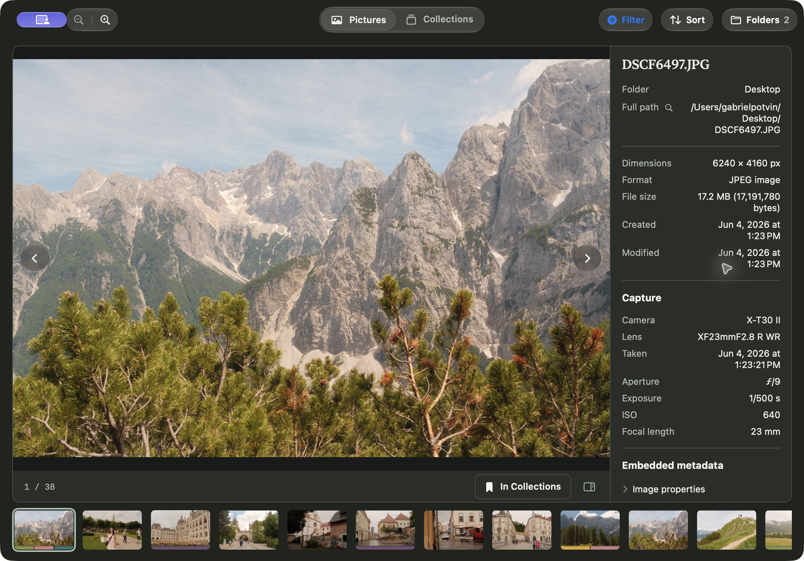
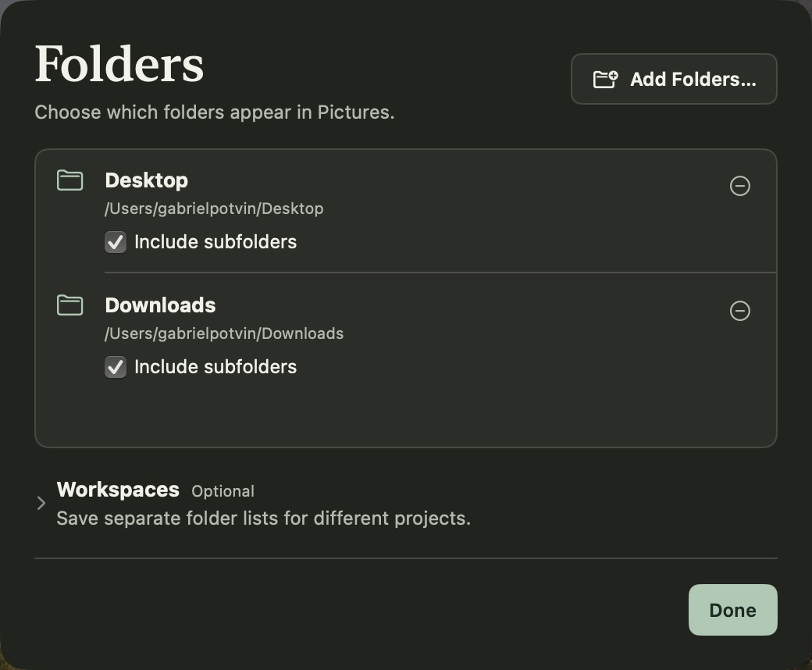
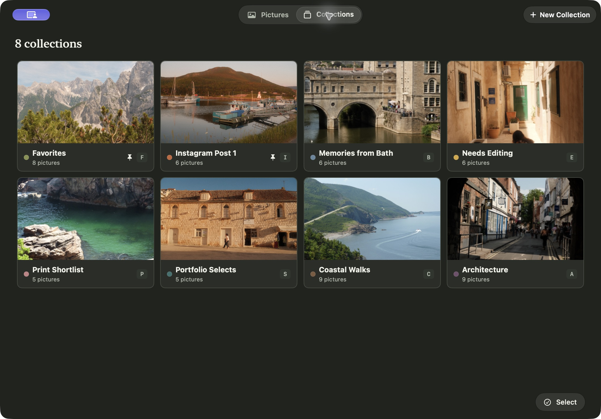
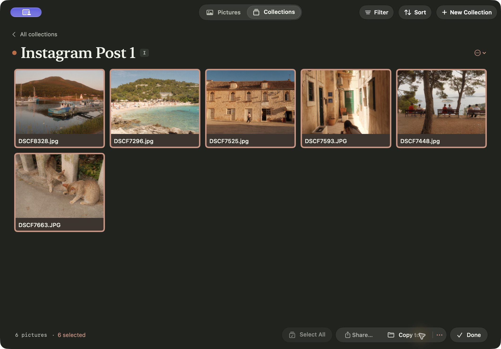

# Stillframe

Stillframe is a native macOS photo browser by **Gabriel Potvin**. Point it at folders you already use, browse your photographs at full window size, and press a letter to add a keeper to a collection. The same frame can be a favorite, the opening shot of a travel post, and a candidate for a print. It stays in its original folder.



## Getting started

[Build Stillframe for your Mac](#build-from-source), then open **Stillframe.app**. It runs on macOS 14 Sonoma or later.

1. Choose **Add Folders…** in the welcome walkthrough, or drag folders from Finder into **Pictures**. The example below includes **Desktop** and **Downloads**. Keeping **Include subfolders** checked also brings in shoots filed under Desktop, such as the Bath photographs.
2. Use **←** and **→** to browse. When you find a keeper, choose **Add to Collection → New Collection…**. Name it *Favorites*, pick a color, and assign **F**.
3. Continue through the filmstrip. Press **F** to add or remove the current picture. Open **Collections → Favorites** to see your picks together.



You can skip the three-step walkthrough with **Esc** and revisit it under **Help → Stillframe Walkthrough…**.

## Collections in practice



### Sequence a travel post

Create *Instagram Post 1* and assign **I**. Mark an establishing shot first, then a few details that tell the story. In this six-frame example, the harbor sets the scene, the middle frames move from the beach into town, and two cats close the sequence. Use **Sort → Date added to collection → Oldest first** to review the shots in the order you picked them. Choose **Select → Select All → Copy to…** to gather the originals in an upload folder. Choose their final order when composing the post.



### Cull a shoot and queue edits

Filter to a shoot date or camera and turn off **Group by folder** to review frames from several cards together. Zoom in to check focus, then press **E** to mark promising frames for *Needs Editing*. Keep the queue pinned. Double-click a filmstrip thumbnail to open its original in the Mac’s default app for that file type. When a frame is finished, press **E** again to clear it from the queue. A separate *Portfolio Selects* mark can stay on the same photograph.

### Gather memories across folders

Make a *Memories from Bath* collection for the bridge, street scenes, and small details you want to remember together. Use a capture-date range to find the trip, then mark photos from any of its folders. Months later, those pictures are still in the collection when you switch to a different workspace. Select a few and choose **Share…**, or use **… → Send by Email…** to compose a message with the files attached.

### Choose photographs to print

Mark candidates for *Print Shortlist* as you come across them in other collections. Open the shortlist, check the pixel dimensions in the info sidebar, and zoom in to compare detail. Select the final frames and drag them to a print-order folder in Finder. **Favorites** can keep the wider selection while the print folder holds just the files you intend to send.

## Feature guide

| In the app | What you can do |
| --- | --- |
| **Pictures** | Click a thumbnail, use the arrow keys or the on-screen arrows, or drag the filmstrip scrollbar to travel through a large folder. Use the zoom buttons or pinch to magnify, pan across the image, and choose **Reset zoom** to fit it again. Previews load on demand using the image formats supported by macOS Image I/O. |
| **Photo info** | Toggle the sidebar below the preview. See the file’s path, dimensions, format, size, and filesystem dates. **Show in Finder** reveals the original. When the camera recorded them, the sidebar also shows capture time, camera, lens, aperture, exposure, ISO, and focal length. Expand the embedded metadata groups for details such as EXIF, TIFF, IPTC, or XMP. |
| **Folders and workspaces** | Press **⌘O** to add folders or **⌘R** to refresh. Set subfolder inclusion per source. In **Folders → Workspaces**, create a separate folder list for each project, duplicate a list with its settings, rename it, or delete it. Switch lists in the sheet or using the arrow beside **Folders**. All workspaces share your collections. |
| **Filter** | Combine source folders, part of a filename, format, capture day or inclusive date range, camera, and lens. Pictures remembers filters separately for each workspace during the session. Each open collection has its own filter too. |
| **Sort** | Order by filename, capture date, or modification date in either direction. Collections also support the order in which you added pictures. **Group by folder** keeps containing folders together alphabetically and applies the chosen order inside each. Missing dates sort last. Pictures and each collection retain their sort settings between launches. |
| **Picture statistics** | Click the picture counter to compare the count and total size of matching photos with the full set, including a folder breakdown. A file in overlapping sources counts once under the most specific source. |
| **Collection marks** | Create a collection from the toolbar or while viewing a photo. Choose a preset or custom color and an optional shortcut letter. The letter toggles membership in either carousel. Colored stripes under thumbnails show overlapping memberships. Use **In Collections** to see or change every mark on the current picture. |
| **Collection management** | Click a collection to open its grid, then click a picture to view it. Use a collection’s **…** menu or right-click its cover to edit its name, color, or shortcut, pin it, or delete it. Pinned collections appear first in the overview and marking menu. Select two or more covers and choose **Merge** to replace them with one collection. Shared photos appear once and a merged collection keeps its pin if any source was pinned. |
| **Selection and delivery** | In either grid, use **Select**, **Select All**, or drag across cards. In a photo grid, drag selected files to Finder, choose **Share…** or **Copy to…**, compose an email, or remove the selection from the collection. Copying into a folder adds a numeric suffix if a filename already exists. **Done** ends selection mode. |
| **Navigation** | Swipe horizontally with two fingers in the top toolbar to switch between Pictures and Collections. Inside a collection, **Esc** or a rightward two-finger swipe goes back one level. The interface follows the Mac’s light or dark appearance. |

### Where the library lives

Stillframe saves folder references, workspace lists, collection membership, colors, shortcuts, pins, and sort settings in `~/Library/Application Support/Stillframe/library.json`. Removing a source folder preserves its collection marks. Deleting a collection removes its marks and leaves the original images in place.

## Build from source

Use Xcode or Apple’s Command Line Tools with the macOS 26 SDK or later. From a checkout of this repository, run the following commands.

```sh
./build.sh
open Stillframe.app
```

The script builds for the current Mac, assembles the app bundle, signs it locally, and verifies its signature. To run the Swift Testing suite, open `Package.swift` in Xcode and choose **Product → Test**. For the standalone Command Line Tools, use the bundled test plug-in.

```sh
swift test --disable-sandbox -Xswiftc -plugin-path -Xswiftc /Library/Developer/CommandLineTools/usr/lib/swift/host/plugins/testing
```

App and photographs by **Gabriel Potvin**. The welcome screen and stacked-print app icon use the mountain photograph `DSCF6497.JPG` shown above.
