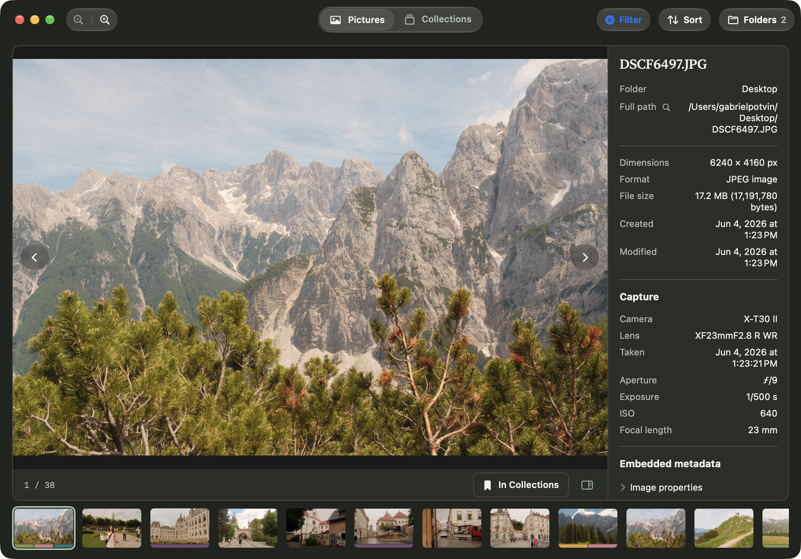
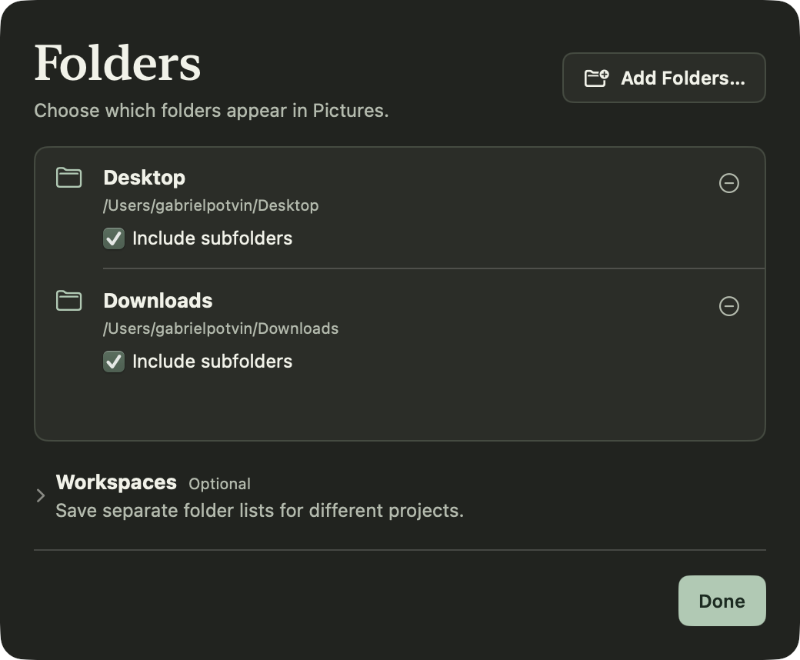
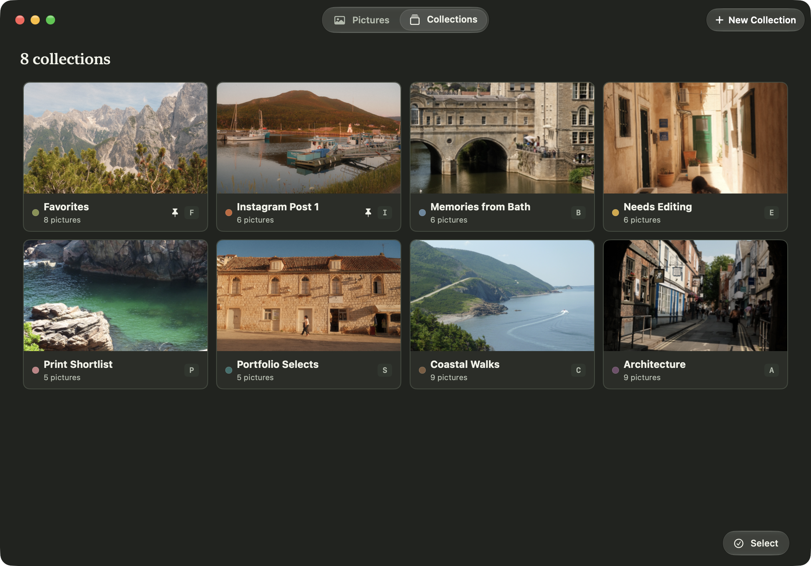
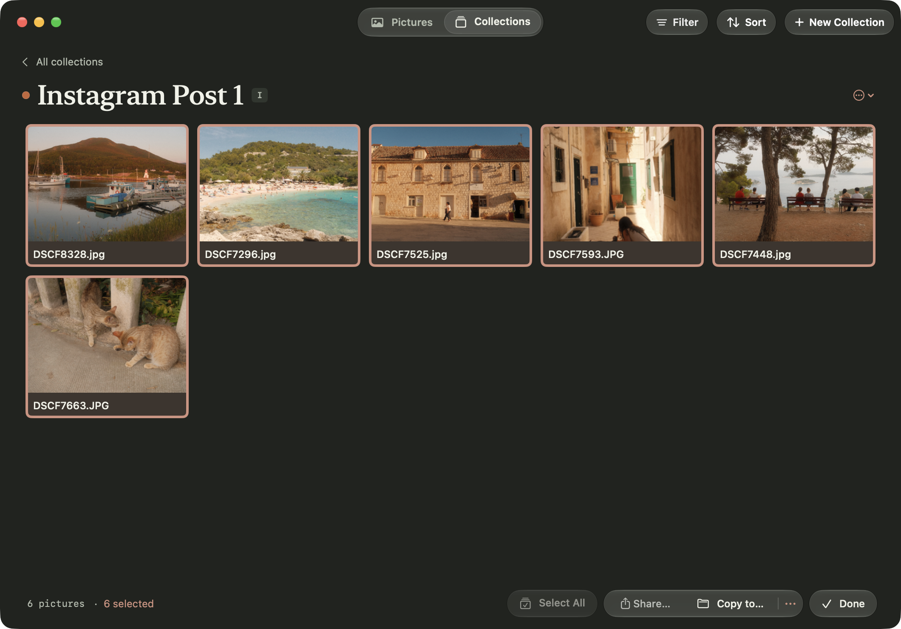

# Stillframe

**A simple, native photo browser for macOS.**

Browse photographs directly from the folders on your Mac. Move through a shoot with the arrow keys and press a letter to mark a keeper. One photo can belong to *Favorites*, *Instagram Post 1*, and *Print Shortlist* while the original stays in its folder.

**[Download Stillframe for macOS](https://github.com/potvingab/Stillframe/releases/latest)** · macOS 14 or later · Apple silicon and Intel



## Getting started

Download the macOS ZIP, unzip it, and move **Stillframe.app** to Applications. The downloadable app is ad-hoc signed and has no Apple notarization. You can also [build it from source](#build-from-source).

1. **Add your folders.** Choose **Add Folders…** in the welcome walkthrough, or drag folders from Finder into **Pictures**. Turn on **Include subfolders** to see the shoots inside them.
2. **Browse your photos.** Press **←** or **→** to move through the filmstrip. Pinch to inspect a detail or open the info sidebar to see how the shot was taken.
3. **Mark your first favorite.** Choose **Add to Collection → New Collection…**, name it *Favorites*, pick a color, and assign **F**. Click **Create and Add** to include the current photo.
4. **Review your favorites.** Press **F** on another photo to add it. Press it again to remove the mark. Open **Collections → Favorites** to see your picks together.



Press **Esc** to skip the walkthrough. You can reopen it under **Help → Stillframe Walkthrough…**.

## Organize with collections

Create collections for a trip, an editing queue, or a set of prints. Give each one a color and an optional shortcut letter. The colored stripes beneath a thumbnail show all the collections that photo belongs to.



### Plan an Instagram post

Create *Instagram Post 1* and assign **I**. Mark the photos in the order you want to tell the story. The six-photo sequence below opens at the harbor, follows the beach into town, and ends with two cats.

To review the sequence, open **Sort**, choose **Date added to collection**, and select **Oldest first**. Choose **Select → Select All → Copy to…** to gather the originals in an upload folder. Set their final order when composing the post.



### Review a shoot for editing

Assign **E** to *Needs Editing* and pin the collection. Filter by shoot date or camera, zoom in to check focus, and press **E** on frames you want to edit.

Double-click a filmstrip thumbnail to open the original in your Mac’s default app for that file type. Back in Stillframe, press **E** again to clear a finished frame from the queue. Its *Portfolio Selects* mark can stay.

### Gather trip photos from different folders

Filter to the dates of your Bath trip, then mark the bridge, street scenes, and small details for *Memories from Bath*. You can gather pictures from several folders and return to them from any workspace. To send a few favorites, select them and choose **Share…** or **… → Send by Email…**.

### Choose photographs to print

Assign **P** to *Print Shortlist* and mark candidates as you browse. Open the collection to check pixel dimensions in the info sidebar and zoom in to compare detail. Drag the final selection into a Finder folder for the print shop.

## Features

### Browse and inspect

- **Filmstrip and zoom.** Click a thumbnail or an on-screen arrow, or drag the filmstrip scrollbar to jump ahead. Use the zoom buttons or pinch, pan to inspect detail, then choose **Reset zoom**. Stillframe loads previews on demand using macOS Image I/O.
- **Photo information.** The sidebar shows the file’s path, dimensions, format, size, and dates. When available, it also shows capture time, camera, lens, aperture, shutter speed, ISO, and focal length. Expand EXIF, TIFF, IPTC, or XMP for more detail, or choose **Show in Finder** to locate the original.
- **Navigation.** Press **⌘1** for Pictures or **⌘2** for Collections, or swipe across the toolbar with two fingers. Inside a collection, press **Esc** or swipe right with two fingers to go back. The app follows your Mac’s light or dark appearance.

### Folders, filters, and sorting

- **Folders and workspaces.** Press **⌘O** to add folders and **⌘R** to refresh them. Use **Folders → Workspaces** to create, duplicate, rename, or delete project folder lists. Switch lists there or with the arrow beside **Folders**. All workspaces share your collections.
- **Filter.** Combine source folders, part of a filename, file format, capture day or date range, camera, and lens. Each workspace and collection remembers its filters for the session.
- **Sort.** Sort by filename, date taken, or date modified in either direction. Inside a collection, you can also sort by date added. **Group by folder** keeps folders together alphabetically. Missing dates sort last. Your order is saved between launches.
- **Picture statistics.** Click the picture counter for counts and file sizes before and after filtering, with a breakdown by folder. Overlapping sources count each file once.

### Manage and share selections

- **Organize collections.** Use **In Collections** to change a photo’s marks. Right-click a cover or open its **…** menu to rename, recolor, pin, or delete a collection, or change its shortcut. Pinned collections appear first in the overview and the marking menu.
- **Merge collections.** Select two or more covers and choose **Merge…**. The new collection replaces the selected collections and includes each photo once. It stays pinned if any of them were pinned.
- **Select and share files.** In a collection grid, use **Select**, **Select All**, or drag across cards. Drag the selection to Finder, choose **Share…** or **Copy to…**, or open **…** to email the files or remove their collection marks. Copies get a numeric suffix if a filename already exists. Choose **Done** to finish.

## Where your library lives

Stillframe saves folder references, workspaces, collection marks, colors, shortcuts, pins, and sort settings in `~/Library/Application Support/Stillframe/library.json`. Removing a source folder preserves its collection marks. Deleting a collection leaves the original photographs in place.

## Build from source

Use Xcode or Apple’s Command Line Tools with the macOS 26 SDK or later. Run these commands from the repository folder.

```sh
./build.sh
open Stillframe.app
```

The script builds Stillframe for your Mac, signs the app bundle locally, and verifies its signature.

To run the tests in Xcode, open `Package.swift` and choose **Product → Test**. With the standalone Command Line Tools, use the bundled Swift Testing plug-in.

```sh
swift test --disable-sandbox -Xswiftc -plugin-path -Xswiftc /Library/Developer/CommandLineTools/usr/lib/swift/host/plugins/testing
```

## License

The [MIT License](LICENSE) covers the source code and documentation text. All rights are reserved for the photographs, screenshots, and photo-based app icon.
